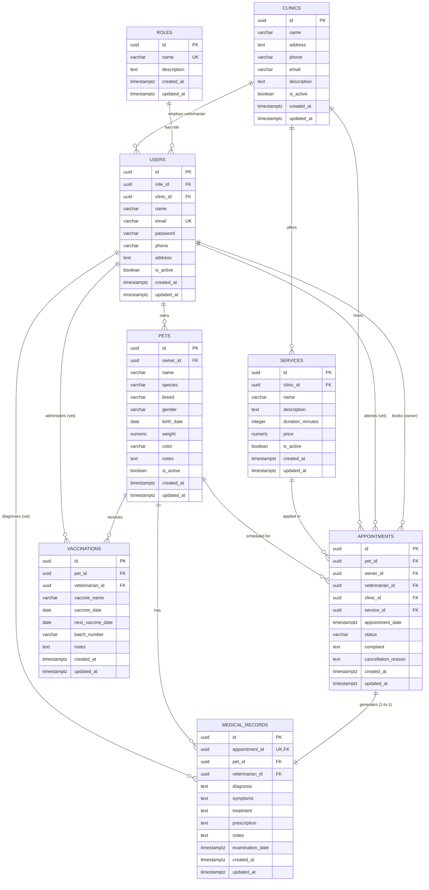

# PETRIVA — Database Design & Entity Relationship Diagram (ERD)

## 1. Konsep Database
PETRIVA menggunakan **PostgreSQL** dengan tipe data primary key **UUID v4** untuk menjamin keunikan identitas data tanpa bergantung pada sequence auto-increment numerik. Seluruh foreign key memiliki relasi integritas referensial yang ketat (`ON UPDATE CASCADE ON DELETE RESTRICT` atau `SET NULL`).

---

## 2. Entity Relationship Diagram (ERD)

---

## 3. Rincian Skema Tabel

### 3.1. `roles`
Menyimpan peran pengguna sistem: `ADMIN`, `PET_OWNER`, `VETERINARIAN`.
- `id` (UUID, PK)
- `name` (VARCHAR(50), UNIQUE, NOT NULL)
- `description` (TEXT)
- `created_at`, `updated_at` (TIMESTAMPTZ)

### 3.2. `clinics`
Menyimpan informasi klinik cabang atau pusat.
- `id` (UUID, PK)
- `name` (VARCHAR(150), NOT NULL)
- `address` (TEXT, NOT NULL)
- `phone` (VARCHAR(30))
- `email` (VARCHAR(150))
- `description` (TEXT)
- `is_active` (BOOLEAN, DEFAULT true)
- `created_at`, `updated_at` (TIMESTAMPTZ)

### 3.3. `users`
Menyimpan akun pengguna seluruh role.
- `id` (UUID, PK)
- `role_id` (UUID, FK -> roles.id)
- `clinic_id` (UUID, NULLable, FK -> clinics.id) -> Wajib diisi jika role `VETERINARIAN`
- `name` (VARCHAR(150), NOT NULL)
- `email` (VARCHAR(150), UNIQUE, NOT NULL)
- `password` (VARCHAR(255), NOT NULL, bcrypt hash)
- `phone` (VARCHAR(30))
- `address` (TEXT)
- `is_active` (BOOLEAN, DEFAULT true)
- `created_at`, `updated_at` (TIMESTAMPTZ)

### 3.4. `pets`
Menyimpan profil hewan peliharaan milik pemilik.
- `id` (UUID, PK)
- `owner_id` (UUID, FK -> users.id)
- `name` (VARCHAR(100), NOT NULL)
- `species` (VARCHAR(50), NOT NULL) -> `CAT`, `DOG`, `BIRD`, `RABBIT`, `OTHER`
- `breed` (VARCHAR(100))
- `gender` (VARCHAR(20), NOT NULL) -> `MALE`, `FEMALE`, `UNKNOWN`
- `birth_date` (DATE)
- `weight` (NUMERIC(6,2))
- `color` (VARCHAR(50))
- `notes` (TEXT)
- `is_active` (BOOLEAN, DEFAULT true) -> *Soft delete support*
- `created_at`, `updated_at` (TIMESTAMPTZ)

### 3.5. `services`
Katalog tindakan atau perawatan yang disediakan klinik.
- `id` (UUID, PK)
- `clinic_id` (UUID, FK -> clinics.id)
- `name` (VARCHAR(150), NOT NULL)
- `description` (TEXT)
- `duration_minutes` (INTEGER, DEFAULT 30)
- `price` (NUMERIC(12,2), DEFAULT 0)
- `is_active` (BOOLEAN, DEFAULT true)
- `created_at`, `updated_at` (TIMESTAMPTZ)

### 3.6. `appointments`
Reservasi janji temu konsultasi / tindakan medis hewan.
- `id` (UUID, PK)
- `pet_id` (UUID, FK -> pets.id)
- `owner_id` (UUID, FK -> users.id)
- `veterinarian_id` (UUID, FK -> users.id)
- `clinic_id` (UUID, FK -> clinics.id)
- `service_id` (UUID, FK -> services.id)
- `appointment_date` (TIMESTAMPTZ, NOT NULL)
- `status` (VARCHAR(30), CHECK: `PENDING`, `CONFIRMED`, `IN_PROGRESS`, `COMPLETED`, `CANCELLED`, `REJECTED`)
- `complaint` (TEXT)
- `cancellation_reason` (TEXT, NULLable)
- `created_at`, `updated_at` (TIMESTAMPTZ)

### 3.7. `medical_records`
Catatan rekam medis pemeriksaan dokter hewan (relasi 1-to-1 dengan appointment).
- `id` (UUID, PK)
- `appointment_id` (UUID, UNIQUE, FK -> appointments.id)
- `pet_id` (UUID, FK -> pets.id)
- `veterinarian_id` (UUID, FK -> users.id)
- `diagnosis` (TEXT, NOT NULL)
- `symptoms` (TEXT)
- `treatment` (TEXT)
- `prescription` (TEXT)
- `notes` (TEXT)
- `examination_date` (TIMESTAMPTZ, DEFAULT now())
- `created_at`, `updated_at` (TIMESTAMPTZ)

### 3.8. `vaccinations`
Catatan buku vaksinasi hewan peliharaan.
- `id` (UUID, PK)
- `pet_id` (UUID, FK -> pets.id)
- `veterinarian_id` (UUID, FK -> users.id)
- `vaccine_name` (VARCHAR(150), NOT NULL)
- `vaccine_date` (DATE, NOT NULL)
- `next_vaccine_date` (DATE, NULLable)
- `batch_number` (VARCHAR(100), NULLable)
- `notes` (TEXT)
- `created_at`, `updated_at` (TIMESTAMPTZ)

