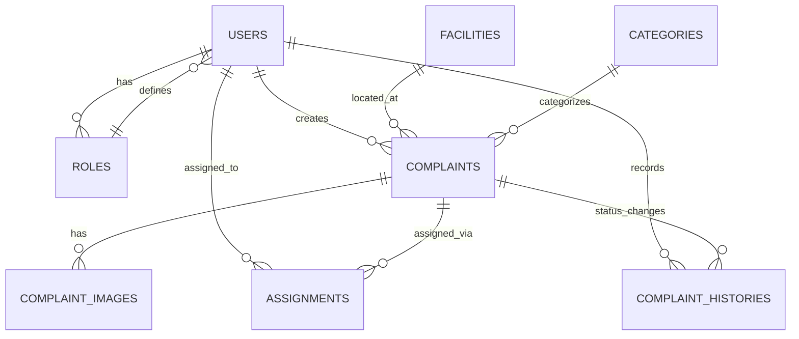

## Database Design

### Entity Relationship Diagram (Mermaid)

### Tabel dan Kolom

#### users
| Kolom | Tipe | Keterangan |
|------|------|------------|
| id | UUID (PK) | Primary key |
| role_id | UUID (FK) | Referensi `roles.id` |
| name | VARCHAR(100) | |
| email | VARCHAR(150) | UNIQUE |
| password | VARCHAR(255) | bcrypt hash |
| phone | VARCHAR(20) | |
| student_number | VARCHAR(30) | Nullable |
| is_active | BOOLEAN | Default true |
| created_at | TIMESTAMP | Default now |
| updated_at | TIMESTAMP | Default now |

#### roles
| Kolom | Tipe | Keterangan |
|------|------|------------|
| id | UUID (PK) |
| name | VARCHAR(50) | UNIQUE (admin, mahasiswa, petugas) |
| description | TEXT |
| created_at | TIMESTAMP |
| updated_at | TIMESTAMP |

#### facilities
| Kolom | Tipe | Keterangan |
|------|------|------------|
| id | UUID (PK) |
| name | VARCHAR(100) |
| location | VARCHAR(150) |
| description | TEXT |
| condition | VARCHAR(50) |
| created_at | TIMESTAMP |
| updated_at | TIMESTAMP |

#### categories
| Kolom | Tipe | Keterangan |
|------|------|------------|
| id | UUID (PK) |
| name | VARCHAR(100) |
| description | TEXT |
| created_at | TIMESTAMP |
| updated_at | TIMESTAMP |

#### complaints
| Kolom | Tipe | Keterangan |
|------|------|------------|
| id | UUID (PK) |
| user_id | UUID (FK) -> users.id |
| facility_id | UUID (FK) -> facilities.id |
| category_id | UUID (FK) -> categories.id |
| title | VARCHAR(200) |
| description | TEXT |
| priority | VARCHAR(20) | ENUM (LOW, MEDIUM, HIGH, URGENT) |
| status | VARCHAR(20) | ENUM (SUBMITTED, VERIFIED, ASSIGNED, IN_PROGRESS, RESOLVED, REJECTED, CLOSED) |
| created_at | TIMESTAMP |
| updated_at | TIMESTAMP |

#### complaint_images
| Kolom | Tipe | Keterangan |
|------|------|------------|
| id | UUID (PK) |
| complaint_id | UUID (FK) -> complaints.id |
| image_path | VARCHAR(255) |
| created_at | TIMESTAMP |

#### assignments
| Kolom | Tipe | Keterangan |
|------|------|------------|
| id | UUID (PK) |
| complaint_id | UUID (FK) -> complaints.id |
| officer_id | UUID (FK) -> users.id |
| assigned_by | UUID (FK) -> users.id |
| assigned_at | TIMESTAMP |
| notes | TEXT |

#### complaint_histories
| Kolom | Tipe | Keterangan |
|------|------|------------|
| id | UUID (PK) |
| complaint_id | UUID (FK) -> complaints.id |
| user_id | UUID (FK) -> users.id |
| old_status | VARCHAR(20) |
| new_status | VARCHAR(20) |
| notes | TEXT |
| created_at | TIMESTAMP |

### Indexes
- `users.email` (unique)
- `complaints.status`
- `complaints.priority`
- `complaints.created_at`
- `assignments.officer_id`
- `assignments.complaint_id`

### Constraint & Integrity
- Semua foreign key menggunakan `ON UPDATE CASCADE ON DELETE RESTRICT`.
- Soft delete di‑implementasikan melalui kolom `is_active` pada tabel `users` dan optional `deleted_at` bila diperlukan pada tabel lain.
- Transaksi dipakai pada operasi yang memodifikasi lebih dari satu tabel (mis. assignment + status update).

*Dokumen ini disusun dalam bahasa Indonesia formal.*
