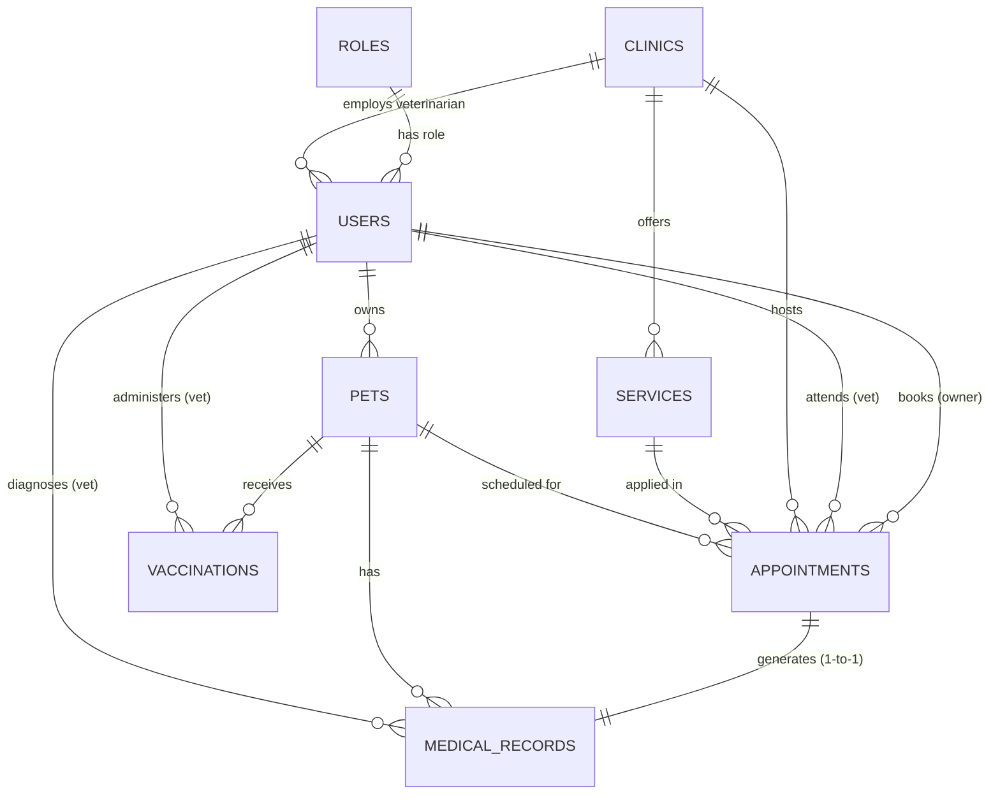

# LAPORAN RANCANGAN SISTEM DAN BOILERPLATE BACKEND
## PETRIVA — Pet Care Management System

---

**Program Studi:** D4 Teknik Informatika  
**Fakultas:** Fakultas Vokasi  
**Perguruan Tinggi:** Universitas Airlangga  
**Tahun:** 2026  

---

## Identitas Kelompok (Kelompok 2)

| No | Nama Lengkap | NIM | Peran Utama |
|---|---|---|---|
| 1 | **MOHAMMAD ANHAZ ABDILAH** | **434241102** | Git Master, Software Architect, Core Backend Engineer |
| 2 | **OKTA ROMAN SANJAYA** | **434241108** | Database Engineer, Service & Repository Developer |
| 3 | **DANU ADJI FERYANTO** | **434241111** | QA Engineer, Middleware & Swagger UI Documentation |

**Link Repository GitHub:** https://github.com/AanFLenrir/PetrivaBackend

---

## 1. Latar Belakang & Identitas Sistem

### 1.1 Identitas Sistem
- **Nama Sistem:** PETRIVA
- **Kepanjangan:** Pet Care Management System
- **Teknologi Utama:** Go (Golang) v1.26, Fiber v2, PostgreSQL, pgx v5, JWT, bcrypt, Swagger UI
- **Pola Arsitektur:** Clean Architecture (Tanpa layer controller maupun handler)

### 1.2 Latar Belakang
Manajemen perawatan hewan peliharaan konvensional masih menghadapi berbagai kendala operasional, seperti ketiadaan jadwal reservasi yang terpusat, risiko jadwal bentrok pada dokter hewan, serta rekam medis dan buku vaksinasi fisik yang rentan hilang atau rusak.

**PETRIVA** dikembangkan sebagai backend REST API modern yang mengintegrasikan kebutuhan pemilik hewan (*pet owner*), dokter hewan (*veterinarian*), dan manajemen klinik (*admin*). Sistem ini menyediakan pencatatan digital terstruktur untuk profil hewan, reservasi jadwal konsultasi medis, rekam medis diagnosis dan resep, serta buku vaksinasi digital berkala.

---

## 2. Tujuan & Manfaat Sistem

1. **Efisiensi Penjadwalan:** Menyediakan reservasi janji temu konsultasi otomatis dengan deteksi dan pencegahan jadwal bentrok (*conflict detection*).
2. **Integritas Rekam Medis:** Memastikan rekam medis hanya dapat dicatat oleh dokter hewan penanggung jawab dan terlindungi dari akses lintas pemilik (*ownership isolation*).
3. **Buku Vaksinasi Digital:** Mendokumentasikan riwayat vaksinasi lengkap dengan batch number dan tanggal vaksinasi berkala berikutnya.
4. **Skalabilitas & Kinerja Tinggi:** Memanfaatkan framework Go Fiber v2 dan connection pool pgx v5 dengan prinsip Clean Architecture.
5. **Kemudahan Integrasi:** Menyediakan dokumentasi interaktif otomatis berbasis Swagger UI di `/swagger/`.

---

## 3. Fitur Utama & Batasan Sistem

### 3.1 Fitur Utama
1. **Autentikasi & Autorisasi Terpusat:** Registrasi pemilik hewan, login multi-role dengan token JWT, password hash bcrypt.
2. **Manajemen Hewan Peliharaan:** CRUD data hewan peliharaan (kucing, anjing, burung, kelinci, dll.) dengan soft delete.
3. **Manajemen Klinik & Layanan:** Katalog klinik hewan dan daftar layanan medis/tindakan klinik.
4. **Reservasi Janji Temu (Appointment):** Pengelolaan reservasi dengan state machine teratur (`PENDING`, `CONFIRMED`, `IN_PROGRESS`, `COMPLETED`, `CANCELLED`, `REJECTED`).
5. **Rekam Medis Digital:** Catatan diagnosis, gejala, tindakan klinis, dan resep obat yang terhubung 1-to-1 dengan appointment.
6. **Buku Vaksinasi Digital:** Catatan vaksinasi berkala hewan peliharaan.
7. **Dashboard Statistik Multi-Role:** Ringkasan statistik operasional yang disesuaikan untuk Admin, Dokter Hewan, dan Pemilik Hewan.
8. **Interactive Swagger UI:** Pengujian endpoint langsung melalui browser di `http://localhost:3000/swagger/`.

### 3.2 Batasan Sistem
- Sistem berfokus pada manajemen layanan dan rekam medis perawatan hewan.
- Tidak mencakup toko daring pakan/perlengkapan hewan, marketplace adopsi, integrasi pembayaran digital, maupun perangkat IoT.

---

## 4. Role Pengguna & Hak Akses

1. **ADMIN:** Memiliki wewenang mengelola pengguna (membuat dokter hewan dengan klinik terdaftar, mengelola admin), data klinik, katalog layanan klinik, melihat seluruh appointment, dan memantau statistik global.
2. **PET_OWNER:** Mendaftar mandiri, mengelola profil hewan miliknya, melihat katalog klinik/layanan, memesan janji temu (*appointment*), membatalkan janji temu, dan melihat rekam medis/vaksinasi hewannya.
3. **VETERINARIAN:** Dokter hewan terdaftar pada klinik tertentu. Melihat appointment yang ditugaskan kepadanya, memperbarui status pemeriksaan, mencatat rekam medis (diagnosis dan resep), serta mencatat riwayat vaksinasi.

---

## 5. Perancangan Database & Skema Relasi

### 5.1 Diagram Relasi Entitas (ERD - Mermaid)

### 5.2 Tabel-Tabel Utama
1. **`roles`:** Menyimpan role pengguna (`ADMIN`, `PET_OWNER`, `VETERINARIAN`).
2. **`clinics`:** Data cabang dan fasilitas klinik hewan.
3. **`users`:** Akun pengguna lengkap dengan relasi role dan klinik (untuk dokter hewan).
4. **`pets`:** Profil hewan peliharaan milik pengguna.
5. **`services`:** Katalog tindakan medis dan perawatan klinik beserta durasi dan tarif.
6. **`appointments`:** Reservasi konsultasi janji temu pemilik hewan ke dokter hewan.
7. **`medical_records`:** Catatan rekam medis yang diterbitkan dokter hewan setelah pemeriksaan.
8. **`vaccinations`:** Catatan vaksinasi berkala hewan peliharaan.

---

## 6. Arsitektur Perangkat Lunak (Clean Architecture)

Proyek mematuhi batasan tugas praktikum: **tanpa folder controller, controllers, handler, maupun handlers**.
- **`app/model/`:** Definisi domain entity, DTO request/response, dan konstanta status tanpa dependensi eksternal.
- **`app/repository/`:** Antarmuka (*interfaces*) dan implementasi query parameterized ke PostgreSQL via `pgxpool.Pool`.
- **`app/service/`:** Inti seluruh logika bisnis, validasi masukan, aturan kepemilikan data, dan alur status appointment. Tidak ada impor Fiber (`*fiber.Ctx` dilarang).
- **`route/route.go`:** Adapter HTTP yang mengikat endpoint Fiber secara langsung, memparsing payload, memanggil service, dan mengembalikan format JSON standar.
- **`middleware/`:** Otentikasi JWT dan otorisasi role-based access control.

---

## 7. Hasil Pengujian & Verifikasi

Seluruh pengujian unit test diimplementasikan menggunakan mock repository dan telah diuji secara menyeluruh:

| Modul Pengujian | Kasus Uji | Hasil |
|---|---|:---:|
| **AuthService** | Registrasi sukses, validasi input wajib, cegah duplikasi email, login sukses, verifikasi password salah, tolak akun nonaktif | **PASS (6/6)** |
| **UserService** | Admin buat user, dokter dengan klinik wajib, tolak role tidak valid, ambil user tanpa password hash, deaktivasi user | **PASS (5/5)** |
| **PetService** | Buat data hewan, tolak spesies di luar enum, tolak akses/update hewan orang lain, soft delete hewan | **PASS (4/4)** |
| **AppointmentService** | Buat appointment, tolak hewan orang lain, transisi status PENDING→CONFIRMED→IN_PROGRESS→COMPLETED, pembatalan janji | **PASS (4/4)** |
| **MedicalRecordService** | Dokter ditugaskan mencatat rekam medis & auto-complete appointment, tolak dokter yang tidak ditugaskan | **PASS (2/2)** |
| **Helper (JWT & Bcrypt)** | Generate & validate token, expired token, invalid secret, hash password, check password match/mismatch | **PASS (6/6)** |
| **Middleware** | Missing header, invalid scheme, invalid token, valid token context injection, role admin, role forbidden, multi-role | **PASS (7/7)** |

Verifikasi perintah pengembangan:
- `gofmt -w .` → **LULUS (Format konsisten)**
- `go mod tidy` → **LULUS (Dependensi sinkron)**
- `go vet ./...` → **LULUS (Tanpa peringatan atau error)**
- `go test -v ./...` → **LULUS (Semua 34 unit tests PASS)**
- `go build ./...` → **LULUS (Binary berhasil dikompilasi)**
- `swag init -g main.go -o docs` → **LULUS (Swagger UI spec docs.go, swagger.json, swagger.yaml terbuat)**
